# bash4humans

A ready-made interactive bash, in the spirit of
[zsh4humans](https://github.com/romkatv/zsh4humans): grey suggestions as you
type, syntax highlighting, fuzzy history and completion,
[Powerlevel10k](https://github.com/romkatv/powerlevel10k) ported to bash (its
settings, segments, wizard, instant prompt and git engine), directory history
on Alt+arrows, plugins, and the useful parts of fish that neither bash nor zsh
has.

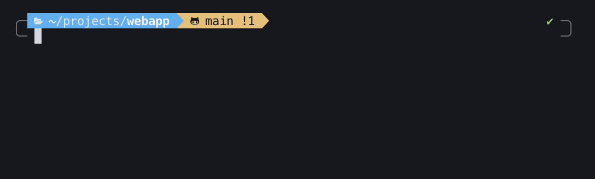

It is still **plain bash**. Only interactive shells change; scripts, `bash -c`,
cron, scp and rsync see an ordinary bash, and `B4H_DISABLE=1 bash` starts one
on demand. Everything lives in your home directory; nothing is installed
system-wide.

## Install

```bash
bash -c "$(curl -fsSL https://raw.githubusercontent.com/GladTechInfo/bash4humans/main/install.sh)"
```

As with zsh4humans, it asks a few one-key questions - key bindings (standard or
vi), full or light line editor, tmux, direnv, what to do with your `~/.bashrc`,
whether bash should become your login shell - then starts the new shell. If
you have a `~/.p10k.zsh`, that first start offers to **convert your
Powerlevel10k prompt**; otherwise (or if you decline) the first prompt starts
Powerlevel10k's configuration wizard, exactly as p10k does in zsh.

Needs Linux (x86_64 or arm64), bash 5, curl or wget, tar, and git (to
download it); make and gawk let it build the pinned ble.sh (else it takes
ble.sh's nightly). **No zsh.** Tested on Arch Linux (bash 5.3), Debian 13
(bash 5.2, a bare container with bash only) and Debian testing. A Nerd Font in
the terminal gives the full prompt; the wizard checks what your font can show.

New installations open an inline fzf picker on Tab. Set `B4H_TAB=menu` in
`~/.bashrc` before bash4humans loads to use the ble.sh menu with descriptions.

For scripts and provisioning, `B4H_UNATTENDED=1` answers every question with
the recommended choice (standard keys, ble.sh, no tmux, `~/.bashrc` replaced)
and starts no shell at the end.

Your old startup files are copied to `~/bash-backup/<date>/`, and the old
`~/.bashrc` is listed, commented out, at the end of the new one.
**Uninstall:** copy the files back and `rm -rf ~/.cache/bash4humans ~/.config/bash4humans`.

## What you get

| | |
|---|---|
| **Suggestions** | grey text from history as you type; **Right**, **Ctrl+F** or **Alt+M** takes it |
| **Highlighting** | commands, options, strings, paths; unknown commands in red |
| **Completion** | TAB opens fzf below the command on new installs: **Ctrl+Space** marks entries, **Ctrl+A** all, Enter inserts them. `B4H_TAB=menu` selects the descriptive ble.sh menu. Option names come from man pages; `**`+TAB is also fuzzy |
| **Fuzzy finder** | **Ctrl+R** history, **Ctrl+T** files, **Alt+C** cd (fzf) |
| **History** | unlimited, timestamped, shared live between open shells; **Up/Down** entries containing what is typed, from this shell's history (what other shells add meanwhile is left out, as in zsh4humans), **Ctrl+Up/Down** entries starting with it, from all shells |
| **Prompt** | Powerlevel10k: lean, classic, rainbow, pure; all its segments and settings, instant and transient prompt - see below |
| **Directories** | **Alt+Left/Right** back/forward, **Alt+Up** parent, **Alt+Down** pick a subdirectory; **Alt+R** (or `cdh`, `cd -`+TAB) any directory you have been to, in any shell; `dirh`, `prevd`, `nextd`; type a directory name to enter it |
| **Editing** | **Ctrl+L** clear the screen (it moves into the scrollback), **Ctrl+Alt+L** clear the scrollback too, **Ctrl+Backspace** delete word, **Ctrl+Alt+Backspace** shell word, **Ctrl+Shift+Left/Right/Delete** move or delete by shell word, **Ctrl+/** or **Shift+Tab** undo, **Alt+/** redo, **Alt+J** clear the line, **Alt+O** stash the line for this shell (Up / Down recall it, and it stays out of saved history until run), **Ctrl+Space** expand the word (alias, `~`, `$VAR`, glob), **Alt+S** toggle sudo, **Alt+H** manual page |
| **Clipboard** | `... \| x` cut, `... \| c` copy (and pass on), `v` paste; over SSH copying reaches your own machine's clipboard (OSC 52) |
| **Abbreviations** | `abbr -a gco git checkout` expands as you type, so history shows the real command |
| **Unknown commands** | "did you mean", and the package that provides it (with `pkgfile` / `command-not-found`) |
| **zsh extras** | `zmv` bulk rename, `alias_suffix txt=nano` (zsh's `alias -s`), `abbr --position anywhere` (zsh's `alias -g`) |
| **fish extras** | `abbr`, `funced`/`funcsave`, `add_path`, `histdel`, `b4h private`, Alt+S, Alt+H |
| **Plugins** | `extract`, `colored-man-pages`, `zoxide`, `ssh-agent`, `git-aliases`, `cht`, and your own |
| **SSH** | `b4h ssh HOST` brings all of this to HOST for that session, without touching HOST's files; with `B4H_SSH_HOSTS` a plain `ssh HOST` does it. Per host: TERM, files brought back, commands run first, or a `b4h_ssh_configure HOST` function that sets them. The session's history stays in bash4humans' own file there (`B4H_SSH_RETRIEVE_HISTORY` brings it back), and a terminal HOST does not know gets its terminfo sent along |

Typing: an unknown command stays red until it is complete, strings and
variables have their own colours, an existing path is underlined, TAB
completes it, and TAB after `--co` lists the options with their descriptions
from the manual page:

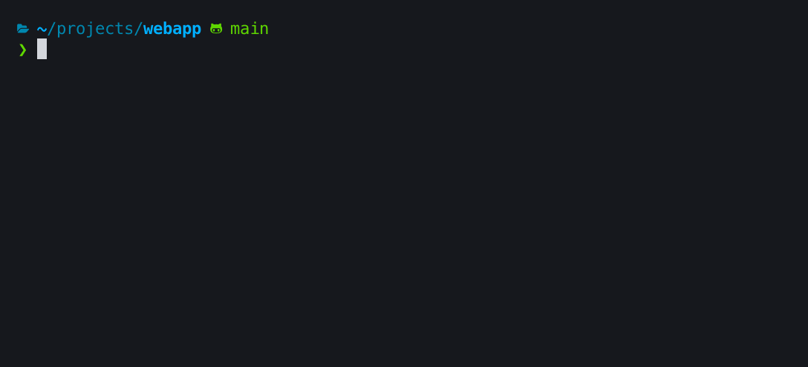

Directories and history: **Alt+Left/Right** back and forward, **Alt+Up** the
parent, **Alt+Down** a subdirectory, **Alt+R** any directory visited before;
**Ctrl+R** searches the history:

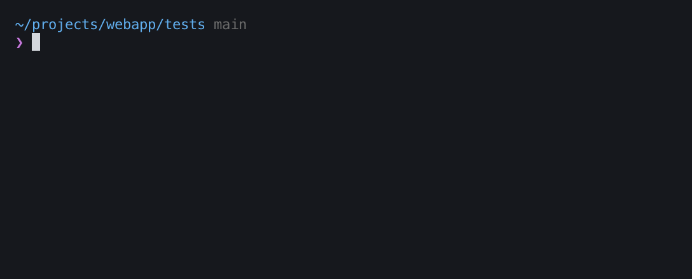

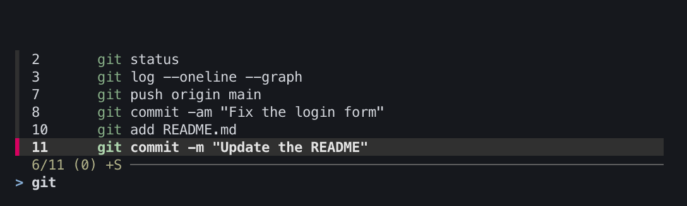

## The prompt

The prompt is [Powerlevel10k](https://github.com/romkatv/powerlevel10k) itself,
ported to bash (`lib/p10k`): the same `POWERLEVEL9K_*` settings with the same
meanings and defaults, all its segments (`dir`, `vcs`, `status`,
`command_execution_time`, `context`, `time`, the language and cloud
segments, `custom_*`, ...), the `p10k` command (`configure`, `reload`,
`segment`, `display`, `help`), the transient prompt, `*_SHOW_ON_COMMAND`, the
instant prompt and the terminal's prompt marks. It is checked against real p10k
in zsh, screen cell by screen cell, by `tests/p10k/` (below).

Its four styles, in the same repository (one file modified, one untracked;
the last command failed):

| Lean | Classic |
|---|---|
| 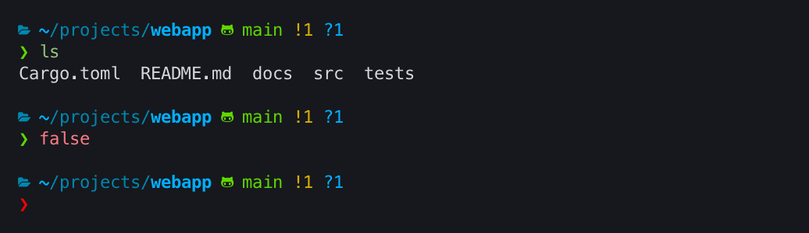 | 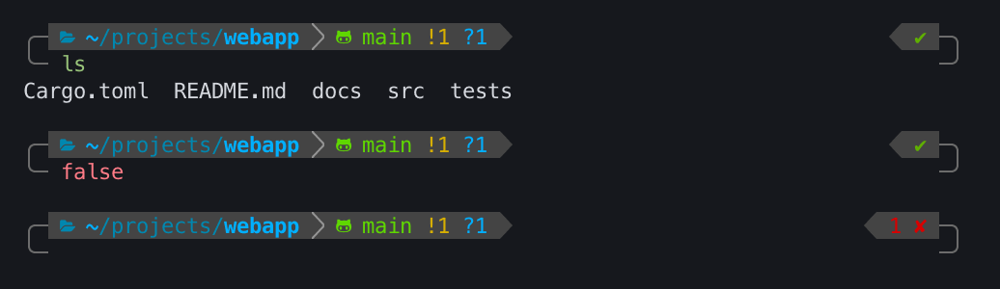 |
| **Rainbow** | **Pure** |
| 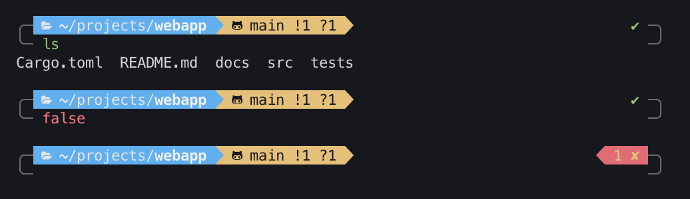 | 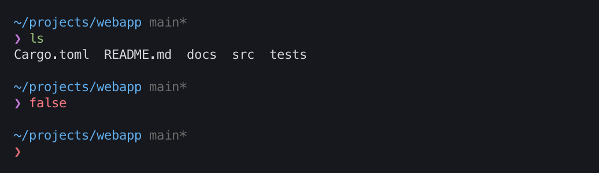 |

`b4h configure` is `p10k configure`: p10k's wizard, with the same screens,
questions and previews. It writes `~/.config/bash4humans/p10k.bash` - a p10k
configuration (the settings of a `~/.p10k.zsh`, converted to bash), with p10k's
comments on every setting. **Adjust it with `b4h prompt edit`** (it reloads
when the editor closes), or run the wizard again.

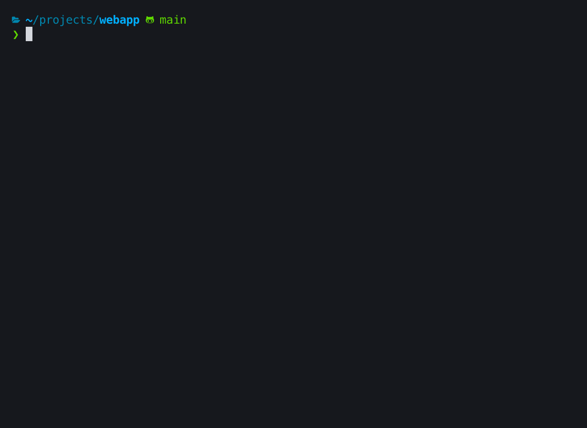

`b4h configure --from-p10k [FILE]` converts an existing Powerlevel10k
configuration (default `~/.p10k.zsh`) instead: your zsh prompt, in bash.

**Instant prompt** (as in p10k, `POWERLEVEL9K_INSTANT_PROMPT=verbose|quiet|off`):
the prompt last seen in a directory appears at once while the rest of the shell
loads; anything start-up prints is kept and shown afterwards (verbose: with
p10k's warning about it).

The exit code of a failed command and the time a slow one took appear on the
right; with the **transient prompt** (`POWERLEVEL9K_TRANSIENT_PROMPT`, a wizard
question) earlier prompts shrink to `❯ command`, so the screen keeps only what
was run:

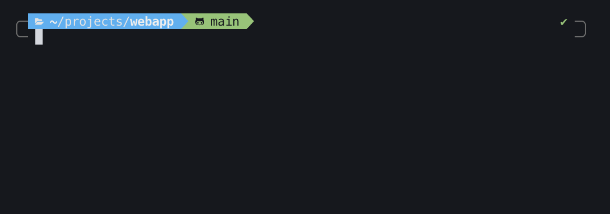

**git** uses [gitstatus](https://github.com/romkatv/gitstatus), Powerlevel10k's
engine, which answers in about a millisecond even in large repositories; it
starts the first time the shell is inside a repository. Under ble.sh a slow
answer redraws the prompt when it arrives, as in zsh. Without gitstatus the
prompt uses `git status`.

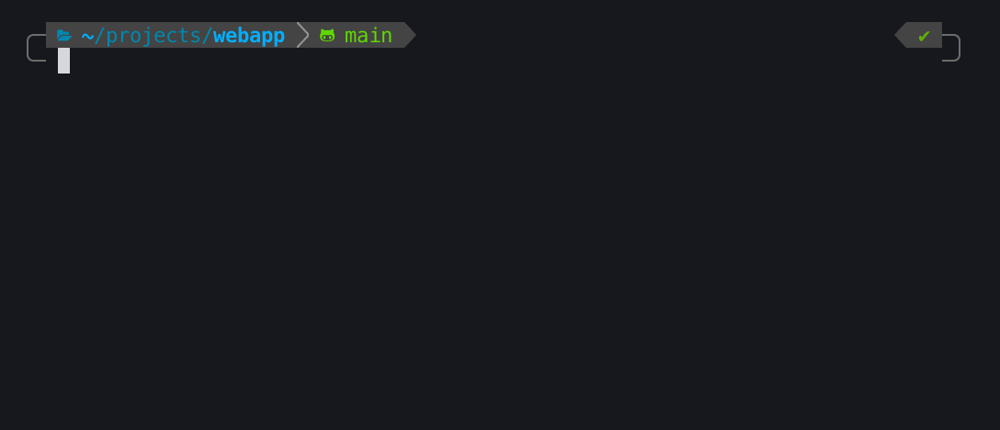

Around the prompt bash4humans adds the terminal's current directory (OSC 7),
the window title - the directory at the prompt, the command while it runs, with
user@host over SSH (`B4H_TITLE`, `B4H_TITLE_IDLE`, `B4H_TITLE_RUNNING`) - and a
notification after long commands (`B4H_NOTIFY_MIN`).

## Commands

```
b4h help | configure | prompt edit | prompt reload | plugins | doctor | update | ssh HOST | private | clipboard | version

abbr -a NAME EXPANSION...              expand where a command goes
abbr -a --position anywhere NAME ...   expand anywhere
abbr -e NAME / abbr                    erase / list

zmv '(*).txt' '$1.md'                  a.txt -> a.md         (-n: dry run)
zmv '(**/)(*).jpeg' '$1$2.jpg'         recursive
zmv -W '*.log' 'old-*.log'             wildcards captured automatically
                                       (-f overwrite, -i ask, -v verbose, -p make dirs, -C copy)
alias_suffix txt=nano pdf=xdg-open     typing notes.txt runs nano notes.txt
funced NAME / funcsave NAME            edit a function / keep it for every shell
add_path [-a] [-P] DIR                 add to PATH once (-a append, -P for every shell)
histdel TEXT                           delete history entries containing TEXT
cdh                                    pick a directory you have been to (fzf; also Alt+R)
dirh / prevd / nextd                   this shell's back / forward history
... | x    ... | c    v                cut / copy (and pass on) / paste
```

The directory history is shared by all shells and kept between them
(`~/.cache/bash4humans/dir-history`, newest first). `x`, `c` and `v` use
wl-clipboard, xclip or xsel on a desktop; elsewhere - over SSH, on a console -
copying sends the text to your terminal (OSC 52), which puts it into the
clipboard of the machine in front of you, and `v` pastes the last copy made on
that host. A name you already use for something else is left alone;
`b4h clipboard` tells which tool is used.

`zmv` refuses to run if any target already exists or two sources would get
the same name; nothing is moved unless every move is safe.

## Plugins

Switch them on in `~/.bashrc` - `B4H_PLUGINS=(extract git-aliases)` - or with
`b4h plugins enable NAME` (which edits that line). `b4h plugins` lists them,
`b4h plugins search WORD` searches. Your own:
`~/.config/bash4humans/plugins/NAME.plugin.bash`, with a `# about:` line.

| | |
|---|---|
| `extract` | `extract FILE...` unpacks any archive into `./NAME/` |
| `colored-man-pages` | manual pages in colour |
| `zoxide` | `z DIR` jumps to a frequently used directory (needs zoxide) |
| `ssh-agent` | one ssh-agent per user, shared between shells |
| `git-aliases` | `g gs ga gc gco gb gd gl gp gpl gst` as abbreviations |
| `cht` | `cht TOPIC [QUERY]` - cheat sheets from cht.sh |

**From any GitHub repository**, as zsh4humans' `z4h install`: in `~/.bashrc`,
after bash4humans is loaded,

```bash
b4h install junegunn/fzf-git.sh               # downloaded once; later starts do nothing
b4h source  junegunn/fzf-git.sh/fzf-git.sh    # source one file from it
b4h install USER/REPO@v1.2                    # a branch, tag or commit instead of the default branch
b4h load    USER/REPO[/DIR]                   # its NAME.plugin.bash (or NAME.bash, init.bash, ...); bin/ goes on PATH
```

Repositories are cloned one commit deep into `~/.cache/bash4humans/repos/`;
`b4h update` brings each up to date (its branch, or the REF given), `b4h plugins`
lists them, `b4h uninstall USER/REPO` deletes one. A download that fails is
reported once and not tried at every start (`b4h update` tries again). The code
runs in your shell, as any plugin's does: install what you trust. Plugins are
sourced inside a function, so a `declare` at their top level makes a local
variable (plain assignments, functions, aliases and exports are unaffected).

## Settings

Set in `~/.bashrc` before bash4humans is loaded; every setting and its
default is in [`lib/settings.bash`](lib/settings.bash).

| Setting | Default | |
|---|---|---|
| `B4H_KEYMAP` | `emacs` | `vi` for vi editing |
| `B4H_LINE_EDITOR` | `ble` | `readline` for plain bash editing (no suggestions/highlighting, ~60 ms start instead of ~300 ms) |
| `B4H_GREETING` | | a command run at start, e.g. `fastfetch` |
| `B4H_PLUGINS` | `()` | plugins to load |
| `B4H_TAB` | `fzf` (new installs), `menu` if unset | `fzf`: inline picker below the command. Ctrl+Space marks, Ctrl+A marks all, Enter inserts the marked entries (or the one under the cursor); Tab / Shift+Tab move. `menu`: ble.sh menu with descriptions |
| `B4H_TAB_RECURSE` | `no` | `yes` (with `B4H_TAB=fzf`): directories offered also list the paths under them (depth `B4H_TAB_RECURSE_DEPTH`=4, at most `B4H_TAB_RECURSE_MAX`=2000; `.git` skipped), as zsh4humans' `recurse-dirs` |
| `B4H_SUGGEST_ACCEPT` | `all` | `word`: Right takes one word |
| `B4H_SHELL_INTEGRATION` | `yes` | OSC 7 / OSC 133 for the terminal (p10k's `TERM_SHELL_INTEGRATION`, switched on) |
| `B4H_TITLE` | `yes` | set the window title: `B4H_TITLE_IDLE` at the prompt (`'\w'`), `B4H_TITLE_RUNNING` while a command runs (`'$B4H_COMMAND'`); over SSH both start with `\u@\h: ` |
| `B4H_HISTORY_LOCAL` | `yes` | Up/Down leave out what other shells add while this one runs (Ctrl+Up/Down always search all); `no`: one shared list. Under ble.sh; readline has one list |
| `B4H_DIR_HISTORY_SIZE` | `10000` | directories kept for Alt+R / `cdh` (0: none) |
| `B4H_CLIPBOARD_COMMANDS` | `yes` | `no`: no `x`, `c`, `v` |
| `B4H_NOTIFY_MIN` | `0` | >0: bell and desktop notification after commands that long (seconds) |
| `B4H_SHELL_INTEGRATION_EXCEPT` | | SSH client addresses whose terminal prints those codes as text |
| `B4H_SSH_SEND_FILES` | `()` | extra files `b4h ssh` copies (never overwrites the host's) |
| `B4H_SSH_HOSTS` | `()` | hosts (patterns: `build-server '*.lab'`) where a plain `ssh HOST` is `b4h ssh HOST`; only interactive logins (no remote command, no `-N`/`-T`/`-f`/`-W`) |
| `B4H_SSH_RETRIEVE_HISTORY` | | a file: after each `b4h ssh` session, its new history lines are appended to it (e.g. `~/.bash_history.remote`) |
| `B4H_SSH_TERM` | `()` | TERM per host: `('*.lab=xterm-256color')` - the first matching pattern wins |
| `B4H_SSH_RETRIEVE_FILES` | `()` | files brought back from the host after a session, to the same path here (`'~/.notes'`; overwritten here) |
| `B4H_SSH_PRELUDE` | `()` | commands run on the host before bash4humans starts (`'export EDITOR=vim'`) |
| `B4H_GIT_BASE` | `https://github.com` | where `b4h install USER/REPO` fetches from (another git host, or a mirror) |
| `B4H_AUTO_UPDATE` | `ask` (template) | offer an update every `B4H_AUTO_UPDATE_DAYS` (28) |
| `B4H_START_TMUX` / `B4H_DIRENV` | `no` | |
| `B4H_FIX_LOCALE` | `yes` | with no UTF-8 locale in effect (none set, `C`, or one not installed), set `LC_ALL` to `C.UTF-8` (else `en_US.UTF-8`, else another UTF-8 locale), as zsh4humans does; `no`: leave it |
| `B4H_PROMPT_AT_BOTTOM` | `no` | `yes`: the prompt starts on the last row - when the shell starts (the terminal is asked where the cursor is) and after Ctrl+L / Ctrl+Alt+L - as zsh4humans' `prompt-at-bottom` |
| `B4H_WIZARD` | `yes` | `no`: no wizard on the first start (p10k's defaults until `b4h configure`) |

`B4H_PROFILE=1 bash` prints how long each start-up step takes.

## Not possible in bash

zsh glob qualifiers (`*(.om[1,3])`), named directories inside paths (`~w/x`)
and floating-point arithmetic. ble.sh itself takes about a quarter of a second
to load (the instant prompt covers it); `B4H_LINE_EDITOR=readline` avoids it.
Plain readline cannot redraw a prompt that is already on screen, so without
ble.sh there is no transient prompt, no vi-mode indicator change, no
`*_SHOW_ON_COMMAND`, a late git status appears at the next prompt, and the
right part of the prompt is not taken away when the typed line reaches it.

## Components

Downloaded at pinned versions ([`versions.conf`](versions.conf)) and checked
against SHA-256 sums:

| | Licence | |
|---|---|---|
| [ble.sh](https://github.com/akinomyoga/ble.sh) | BSD-3-Clause | the line editor: suggestions, highlighting, menus, abbreviations. Built from a pinned commit (needs git, make, gawk; else the prebuilt nightly) |
| [fzf](https://github.com/junegunn/fzf) | MIT | fuzzy finder (a system fzf is used if installed) |
| [bash-completion](https://github.com/scop/bash-completion) | GPL-2.0 | completions (a system copy is used if installed) |
| [gitstatus](https://github.com/romkatv/gitstatus) | GPL-3.0 | git status for the prompt |
| `b4h-tool` (this repo, Rust) | GPL-3.0-or-later | `zmv`, "did you mean", and `b4h configure --from-p10k` (converting a `~/.p10k.zsh`). Optional: the wizard and the prompt need only bash. The release's static binary is downloaded and checked against its SHA-256; without one it is built with cargo if present |

A component that cannot be had (offline, no cargo) is not tried again at each
start; `b4h update` tries again, and `b4h doctor` shows what is missing.

## Layout

```
b4h.bash              entry point (sourced from ~/.bashrc)
install.sh            the installer          bashrc.template   the ~/.bashrc it writes
lib/settings.bash     defaults               lib/deps.bash     components
lib/options.bash      options, history       lib/completion.bash  completion, fzf
lib/prompt.bash       the prompt: lib/p10k, b4h configure, terminal integration
lib/p10k/             Powerlevel10k for bash (engine, segments, wizard, instant prompt)
p10k/templates/       p10k's own configuration templates (the wizard edits them)
p10k/config/          the templates converted to bash
lib/dirs.bash         directory history  lib/fish.bash         fish features
lib/cnf.bash          unknown commands, zmv  lib/clipboard.bash   x, c, v
lib/keys.bash         key bindings           lib/cmd.bash         the b4h command
lib/plugins.bash      plugin loader          plugins/             bundled plugins
tools/b4h-tool/       Rust helper            tests/               tests (tests/README.md)
tools/tui-capture/    screen capture for the tests (Rust)
tools/term-render/    turns captured screens into the README's images (Rust)
docs/demo/            makes the images: a throwaway HOME, the keys of each shot (shots.sh)
.github/workflows/    CI and releases        docs/releasing.md    how a release is made
THIRD-PARTY.md        what comes from elsewhere, and its licence
```

Build the helper: `cd tools/b4h-tool && cargo build --release --target x86_64-unknown-linux-musl`
(a static binary). `cargo test` runs its tests. `tests/drive.sh RCFILE KEYS...` types
into a real interactive shell. `tests/features.sh` types the keys and commands
borrowed from zsh4humans (Alt+R, Alt+O, Ctrl+Space, the title, `x`/`c`/`v`, ...)
into bash4humans under ble.sh and under readline and checks the screen. What
each test needs: [`tests/README.md`](tests/README.md).

**Checked against real p10k:** `tests/p10k/all.sh` runs every comparison with
Powerlevel10k in zsh (it needs zsh, a p10k checkout in `~/src/powerlevel10k`
and `tools/tui-capture`): the same configuration, keys and directory in both shells,
screens compared cell by cell (character, colours, bold), plus p10k's own
functions run against the port where no screen can be set up.
`tests/p10k/wizard.sh` drives both wizards with the same keys and compares
every screen and the configurations they write.

## Credits

Inspired by [zsh4humans](https://github.com/romkatv/zsh4humans) and
[Powerlevel10k](https://github.com/romkatv/powerlevel10k) by Roman Perepelitsa,
[fish](https://fishshell.com), [liquidprompt](https://github.com/liquidprompt/liquidprompt),
[bash-it](https://github.com/Bash-it/bash-it) and
[oh-my-bash](https://github.com/ohmybash/oh-my-bash).

`lib/p10k` is a port of Powerlevel10k (MIT licence) to bash, and `p10k/templates`
holds p10k's configuration templates unchanged; its licence is in
[`p10k/templates/LICENSE.powerlevel10k`](p10k/templates/LICENSE.powerlevel10k).
gitstatus is used as a component. The heavy lifting in the line editor is
[ble.sh](https://github.com/akinomyoga/ble.sh) by Koichi Murase. Every
third-party part and its licence: [`THIRD-PARTY.md`](THIRD-PARTY.md).

**Contributors:** GladTechInfo, and [Claude](https://claude.com/claude-code)
(Anthropic's AI model, through Claude Code), co-author of the code, the
Powerlevel10k port, the tests and the README's pictures; its commits carry a
`Co-Authored-By: Claude` line.

## Licence

Copyright (C) 2026 GladTechInfo.

bash4humans is free software: you can redistribute it and/or modify it under
the terms of the GNU General Public License as published by the Free Software
Foundation, either version 3 of the License, or (at your option) any later
version. It is distributed in the hope that it will be useful, but WITHOUT ANY
WARRANTY; see [`LICENSE`](LICENSE) for details.

Parts come from other projects under their own licences (Powerlevel10k's MIT
notice stays with the code derived from it); see [`THIRD-PARTY.md`](THIRD-PARTY.md).
